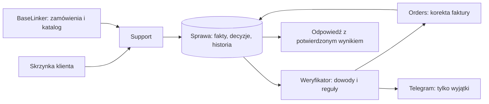

# Hermes Support — od wiadomości klienta do rozliczenia zwrotu

**Support dla sprzedawców marketplace korzystających z BaseLinkera.** Zamiast ręcznie przełączać się między skrzynką, zamówieniem i fakturą, Support łączy kontekst sprawy i przygotowuje odpowiedź, a Orders odpowiada za operacje na dokumentach.

To wydanie udostępnia wybrane istniejące moduły: odczyt zamówień w BaseLinkerze, obsługę IMAP/SMTP, transport próbny bez wysyłki oraz kontrakt HTTP integracji z systemem korekt. Diagram pokazuje architekturę systemu źródłowego, **nie gotowy do wdrożenia proces z tego repo**. Nie dołączono produkcyjnego wykonawcy Orders ani bazy i orkiestracji spraw.

## Konfiguracja komponentów

[Instrukcja krok po kroku: instalacja Hermesa, skrzynka, BaseLinker i Orders](INSTALL.md).

W Pythonie 3.11+ zainstaluj `python -m pip install -r requirements.txt`. [`.env.example`](.env.example) pokazuje wspierane ustawienia. Własne klucze trzymaj w lokalnym `.env`, poza Gitem. `nexo_support_mcp.config.load_settings` odczytuje konfigurację, ale samo skopiowanie `.env` nie uruchamia agenta. Adapter korekt oczekuje osobnej usługi z `GET /corrections` i `POST /corrections`; nie jest to endpoint BaseLinkera. Adaptery są komponentami bibliotecznymi, nie usługą działającą w tle.

## Scenariusze do demonstracji

- **Gdzie jest paczka?** Agent dopasowuje wątek do zamówienia, sprawdza status i odpowiada bez obiecywania terminu, którego przewoźnik nie potwierdził.
- **Zwrot dostarczony.** Weryfikator wiąże dowód doręczenia z właściwym zamówieniem i zakresem zwrotu. Orders wylicza korektę, a dopiero potwierdzenie dokumentu odblokowuje powiadomienie księgowości. Korekta nie oznacza przelewu.
- **Pomyłka w zamówieniu.** Agent rozróżnia wymianę i zwrot, nie uznaje samego wystawienia etykiety za doręczenie. Gdy dane są sprzeczne, pyta właściciela i wznawia tę samą sprawę po zapisaniu odpowiedzi.
- **Awaria po zleceniu korekty.** Stan pozostaje niepewny. Najpierw weryfikacja, czy dokument powstał, bez automatycznego wystawiania drugiego.
- **Pytanie o produkt lub instrukcję.** Agent korzysta z katalogu i przypisanych dokumentów, nie miesza wariantów ani nie zgaduje parametrów.

## Granice wydania

Moduły można testować offline z podstawionym transportem HTTP i kolejką `ShadowTransport`. Integracja z prawdziwą skrzynką i dokumentami wymaga osobnego wdrożenia, ograniczonych uprawnień i testów. Scenariusze powyżej opisują system źródłowy, nie automatyzację dostarczaną w tym repo.

## Co sprawdzono przed wyodrębnieniem

W tym pakiecie sprawdzono offline parser wiadomości, odczyt zamówienia przez adapter BaseLinkera, kontrakt korekty z kluczem idempotencji oraz odpowiedź zarejestrowaną przez `ShadowTransport`. Nie wysyłano maili i nie wystawiano dokumentów.
